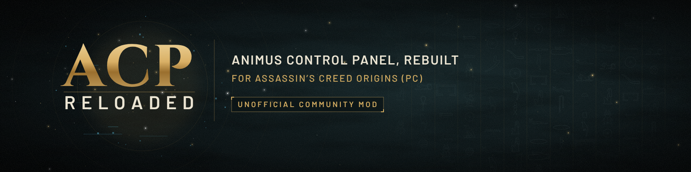
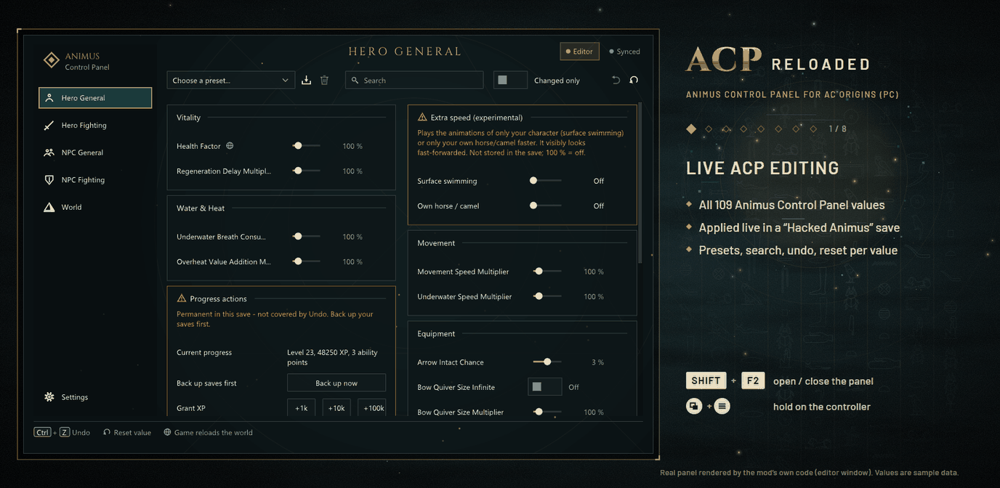

<p align="center">
  
</p>

# ACP Reloaded

**The Animus Control Panel for *Assassin's Creed Origins* (PC), rebuilt as an in-game overlay.**

Ubisoft's original Animus Control Panel ran inside the old Uplay overlay and no longer works with today's Ubisoft
client. ACP Reloaded brings it back: a native DirectX 11 overlay that edits all ACP values live in a
"Hacked Animus" save – with keyboard/mouse and full controller support.

> Unofficial fan-made mod. Not affiliated with or endorsed by Ubisoft. Assassin's Creed is a trademark of
> Ubisoft Entertainment.

## Features




- **All 109 ACP parameters**, applied live in a "Hacked Animus" save (no restart). Presets, search, undo,
  "changed only" filter, reset per value or page.
- **Two looks:** the classic Uplay panel or an *Origins* theme modelled on the game's menus.
- **Full controller support** in console style (D-pad/left stick, LB/RB pages, A/B/X/Y), plus keyboard and mouse.
- **Character choice with portraits** for all 21 ACP characters.
- **Quality of life:** frame rate limiter, FPS/frame time display, sharpening filter, save backup button,
  "create ACP.ini with original values".
- **Experimental game functions** (opt-in, only in a "Hacked Animus" save, checked against the game build and
  switched off on any mismatch):
  - set and hold the exact time of day, own time-lapse clock when a quest locks the ACP day length
  - grant XP, raise the level, grant ability points
  - control the weather
  - teleport to your map marker or the tracked quest target (also from the world map), water surface landing
  - extra speed for surface swimming and your own horse/camel

## Install (Windows 10 / 11)

1. Download the [latest release](https://github.com/justsomesnake/ACP-Reloaded/releases/latest) (also on
   [Nexus Mods](https://www.nexusmods.com/assassinscreedorigins/mods/375)) and copy **`dinput8.dll`** and **`ACPReloaded.dll`** into the game folder
   (next to `ACOrigins.exe`).
2. Start the game and load a "Hacked Animus" save (press **Q** on a save in the load menu).
3. Open the panel with **Shift+F2** (changeable) or hold **View + Menu** on the controller.

Using the Ultimate ASI Loader or another mod with its own `dinput8.dll`? See `docs/README_RELEASE.txt` – both are
supported. Linux / Proton / Steam Deck: add the launch option `WINEDLLOVERRIDES="dinput8=n,b" %command%` (untested).

Uninstall: delete the two DLLs. Game files are never modified. Settings, log, presets and backups live in
`Documents\Assassin's Creed Origins\ACP_Reloaded\`.

## Compatibility

| | Status |
|---|---|
| Steam version (build 16965472) | tested |
| Ubisoft Connect version | untested |
| Proton / Steam Deck | untested |
| ReShade, RTSS, Special K, other overlays | should work side by side, untested |

The experimental game functions are tied to the tested game build; on any other build they stay off and only the
classic ACP features are available.

## Build from source

Requirements: Visual Studio 2022 Build Tools (MSVC, Windows SDK) and CMake 3.25 or newer. Dear ImGui and MinHook are
downloaded at configure time (pinned commits).

```
cmake --preset x64-release
cmake --build --preset x64-release
ctest --preset x64-release
```

The build produces `ACPReloaded.dll`, `dinput8.dll` (optional loader) and `ACPReloaded_Editor.exe`, a standalone
editor for `ACP.ini` with the same interface.

## How it works (short)

The game never reads `ACP.ini`; it receives ACP values only as an event from the Uplay options interface. ACP
Reloaded hooks that interface in `uplay_r1_loader64.dll` and delivers the values itself, so the game applies them as
it did with the original panel. The overlay draws with Dear ImGui on the game's DirectX 11 swap chain. The
experimental game functions call the game's own functions from a game task, verify every function by checksum before
use and never patch the game's code.

## License

ACP Reloaded is licensed under the **GNU General Public License v3.0** – see [`LICENSE`](LICENSE).
Third-party components, fonts and images: see [`THIRD_PARTY.md`](THIRD_PARTY.md).

---

ACP Reloaded is and stays free. If it helped you, a coffee helps me keep building. Thank you!

<a href="https://ko-fi.com/mythenstudios"></a>
